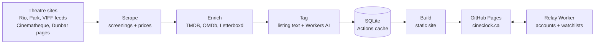

<picture>
  <source media="(prefers-color-scheme: dark)" srcset="docs/logo-dark.png">
  
</picture>

**Vancouver showtimes for film lovers.** Every indie and rep cinema in town on one schedule, with the ratings you'd look up anyway.

**[cineclock.ca](https://cineclock.ca/)**: see what's on tonight, filter by theatre, format or genre, and connect your Letterboxd watchlist to see which of your films are playing.

Vancouver's best screens are its independent and repertory cinemas, but each one lists its showtimes its own way on its own site. Checking five theatres to plan one night out gets old. cineclock reads them all every few hours and puts every screening in one place:

- **Five theatres, one schedule.** The Rio, the Park, the Cinematheque, VIFF Centre (both screens) and the Dunbar.
- **Scores from four places.** Letterboxd, IMDb, Rotten Tomatoes and Metacritic on every film.
- **The special screenings stand out.** 35mm, 70mm, Q&As, festivals and shorts are tagged from each listing, with a cheap AI read for the ones worded unusually.
- **Your watchlist, matched.** Sign in with Google (optional) to save films, connect a Letterboxd or IMDb watchlist and pick your rating source.
- **Never stale.** The site rebuilds every 4 hours. A theatre that fails keeps its last listings, and one that stops updating raises an alert.

Version 2.5.0. See what changed in the [changelog](CHANGELOG.md).

<p>
  
  
  
</p>

## The site

- **Home:** a spotlight of tonight's picks, three shortcut tiles (what's on tonight, the festival of the moment, your watchlist), then rows: on soon, leaving soon, just added, special screenings, the genre of the day, new releases, classics, highly rated
- **Films:** a poster grid with each film once and the dates it's on, sortable and filterable by theatre, format, event and genre
- **Showtimes:** every screening, day by day, with the same filters, a date picker, and day chips that stay on screen and light up the day you're looking at
- **Festivals:** a page for each festival (or packed series) on, with the theatre's banner and blurb, and a page listing them all
- **Theatres:** each theatre's story, prices, room specs and photos, poster rows of what's on, then its showtimes
- **Film pages:** backdrop, poster, synopsis, scores and every showtime beside them on wide screens, with schema.org showtime data for search engines
- **One card everywhere:** every poster card has the same lines in the same spots. Anything special, like 35mm or a Q&A, is a badge on the poster's corner

## How it works



| Stage | Module |
|---|---|
| Scrapers | [`scrapers/`](src/cineclock/scrapers), [`scrape.py`](src/cineclock/scrape.py) |
| Film details and ratings | [`enrich/`](src/cineclock/enrich) |
| Tags | [`ai.py`](src/cineclock/ai.py) |
| Festival pages | [`festivals.py`](src/cineclock/festivals.py) |
| Letterboxd and IMDb lists | [`profiles.py`](src/cineclock/profiles.py), [`imdb_sync.py`](src/cineclock/imdb_sync.py) |
| Database | [`db.py`](src/cineclock/db.py) |
| Pages | [`build.py`](src/cineclock/build.py), [`site.py`](src/cineclock/site.py), [`templates/`](src/cineclock/templates) |
| Accounts, saves and emails | [`relay/`](relay) |

**Reading the theatres.** The Rio, the Park and VIFF publish JSON feeds, which cineclock reads directly. The Cinematheque and the Dunbar have none, so their own listing pages are read. Theatre pages that link a film's IMDb entry give an exact match for posters and ratings.

**Where things live.** Screenings, film details, prices, AI notes and festival pages: SQLite, kept between runs in the Actions cache. Accounts, sessions (stored as hashes), saved films, settings, IMDb lists and email history: the Worker's D1 database. Your Letterboxd username and a copy of your account: your browser's storage.

**Updates.** The [Deploy workflow](.github/workflows/deploy.yml) runs on every push to `main` and every 4 hours: tests, scrape, film details, AI tags, festival pages, build, publish, then a health check that fails (and emails) if a theatre hasn't updated in about 12 hours. A theatre that fails or returns nothing keeps its last listings; one that suddenly loses most of its shows is held, not wiped. Busy or slow sites are asked again twice before giving up.

**Times** are stored in UTC and shown in Vancouver time from the pinned `tzdata` package. The browser and the email job use the build's fixed offset (UTC-7), so B.C.'s move to permanent daylight time can't shift Today or Tonight on devices with older time zone data.

**The relay** (`relay/`, deployed by Cloudflare on every push that changes it) checks Google's signature on sign-in, keeps sessions in an HttpOnly cookie, only accepts changes from the site's own address, reads Letterboxd profiles, and runs the email job.

### Secrets

| Where | Name | What for |
| --- | --- | --- |
| GitHub | `TMDB_API_KEY`, `OMDB_API_KEY` | Film details and ratings |
| GitHub | `CLOUDFLARE_API_TOKEN` (the account ID is in the workflows) | AI tags and the Monday report, on Workers AI's free daily allowance (optional) |
| Cloudflare Worker | `GITHUB_TOKEN` | Start the IMDb sync job straight away (optional) |
| Cloudflare Worker | `RESEND_API_KEY` | Send emails. Not set yet, so no emails go out |

### If a release goes wrong

- **Site:** revert the commit on `main` (`git revert <sha>`, push). Deploy rebuilds from the same database, so no data is lost. To redeploy without a code change, run the Deploy workflow by hand.
- **Relay:** the revert redeploys it too. In Cloudflare, Workers & Pages, cineclock-relay, Deployments, an earlier version can also be rolled back to in one tap. D1 changes only ever add tables or columns, so older code still runs against it.
- **Emails:** remove the `RESEND_API_KEY` secret (or the cron in `relay/wrangler.toml`) to stop sending at once; settings and history stay.
- **Database:** the Actions cache holds screening history, and the weekly job keeps a copy for 90 days (artifact `cineclock-db`). If the cache is ever gone, Deploy restores the newest copy on its own. A bad scrape is undone by the next good one.

### Running without anyone

- Deploy every 4 hours; a health check emails Jordan if a theatre stops updating for about 12 hours.
- Busy or briefly down sites and AI calls are asked again before a run gives up; a failed theatre keeps its last listings.
- If the AI model is retired or won't answer, the next one on the list is used.
- Every Monday: the AI report as a GitHub issue, a database backup, and an empty commit if the repo has been quiet for 45 days (GitHub pauses schedules after 60).
- To have the AI read every listing again: run Deploy by hand with "retag" ticked.

## Run it yourself

Needs Python 3.12 or newer, and Node 22 for the relay tests.

```sh
python -m venv .venv
source .venv/bin/activate
pip install -e ".[dev]"
fastapi dev src/cineclock/app.py   # preview at http://127.0.0.1:8000
```

The preview serves exactly the pages the static build publishes. To scrape every venue into `cineclock.db`:

| Command | What it does |
|---|---|
| `python -m cineclock.scrape` | Read every theatre. `TMDB_API_KEY` and `OMDB_API_KEY` add film details and ratings |
| `python -m cineclock.ai` | AI tags, with `CLOUDFLARE_ACCOUNT_ID` and `CLOUDFLARE_API_TOKEN` (skipped without) |
| `python -m cineclock.festivals` | Festival banners and blurbs |
| `python -m cineclock.build` | Write the site to `site/` |

## Credits

Inspired by [MovieClock](https://movieclock.app) by Jordan Hudson ([source](https://github.com/jordanhudson/moviecal), MIT licensed). Some scraper approaches are borrowed from it. Film details from [TMDB](https://www.themoviedb.org) and [OMDb](https://www.omdbapi.com); this product uses the TMDB API but is not endorsed or certified by TMDB. Fonts are Instrument Sans and Source Serif 4, both under the SIL Open Font License (see `src/cineclock/static/fonts`).

## Development

```sh
pip install -e ".[dev]"
pytest
ruff check . && ruff format --check .
for t in relay/test.mjs relay/account.test.mjs relay/alerts.test.mjs relay/imdb.test.mjs tests/when.test.mjs; do node "$t"; done
```

## License

MIT. See [LICENSE](LICENSE).
