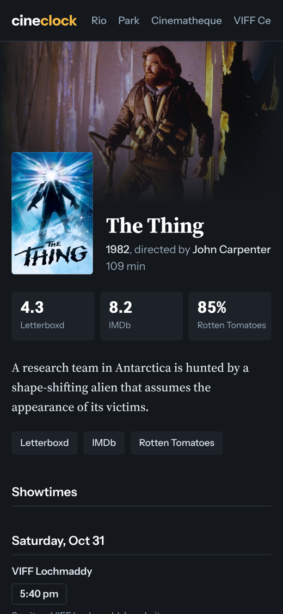

# cineclock

[](https://github.com/yogzoth/cineclock/actions/workflows/ci.yml)
[](https://github.com/yogzoth/cineclock/actions/workflows/deploy.yml)

Vancouver showtimes for film lovers. Indie and rep cinemas in one place.

**Live site: https://yogzoth.github.io/cineclock/**



## Status

Version 1 covers the Rio, the Park, the Cinematheque and VIFF (both screens):

- [x] Scrapers for all four venues, tested against saved real responses
- [x] SQLite storage; reruns update instead of duplicating
- [x] Home page with rows of posters: on today, coming up, on film, highly rated, popular, events, most screenings
- [x] Showtimes page by day, filtered by theatre, tag or title
- [x] Film pages and theatre pages
- [x] Film matching on TMDB for posters, synopsis, director and runtime
- [x] Letterboxd, IMDb and Rotten Tomatoes ratings and links
- [ ] Add to calendar (.ics)
- [x] Tags: 70mm, 35mm, Event, Preview, One screening
- [ ] Letterboxd watchlist and seen films
- [ ] Theatre tech specs

## Running it

Needs Python 3.12 or newer.

```sh
python -m venv .venv
source .venv/bin/activate
pip install -e ".[dev]"
pytest
ruff check .
fastapi dev src/cineclock/app.py
```

Then open http://127.0.0.1:8000. The preview serves exactly the pages the static build publishes.

To scrape every venue and save to `cineclock.db` (set `TMDB_API_KEY` and `OMDB_API_KEY` to also look up film details and ratings):

```sh
python -m cineclock.scrape
```

## How it's deployed

The live site is plain files on GitHub Pages, so it costs nothing and never sleeps. A GitHub Actions workflow runs on every push to `main` and every 4 hours: it runs the tests, scrapes the venues, builds the page with `python -m cineclock.build`, and publishes it. The database is kept between runs in the Actions cache, so past screenings stay as history.

## How it's built

- Python, SQLite, FastAPI with Jinja2 templates
- httpx and BeautifulSoup for scraping
- Each venue scraper has a pure parse function tested against saved sample responses, so tests never hit the network
- Film details come from TMDB, matched on title and year. Each film is looked up once when it first appears and refreshed monthly, so the APIs get a handful of calls a day
- Times are stored in UTC and shown in Vancouver time using the pinned `tzdata` package, so clock rule changes (like B.C.'s 2026 move to permanent daylight time) can't shift a showtime

## Credits

Inspired by [MovieClock](https://movieclock.app) by Jordan Hudson ([source](https://github.com/jordanhudson/moviecal), MIT licensed). Some scraper approaches are borrowed from it.

## Fonts

Instrument Sans and Source Serif 4, both under the SIL Open Font License (see `src/cineclock/static/fonts`).

## License

MIT. See [LICENSE](LICENSE).
