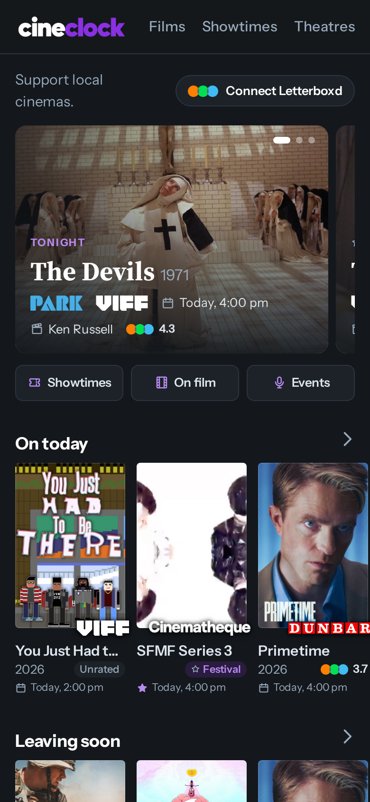
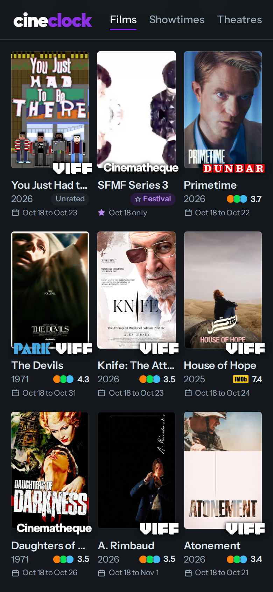
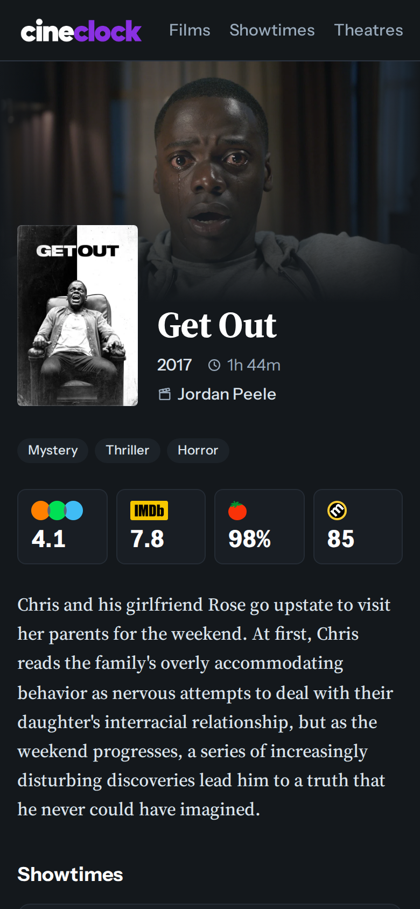

# cineclock

[](https://github.com/yogzoth/cineclock/actions/workflows/ci.yml)
[](https://github.com/yogzoth/cineclock/actions/workflows/deploy.yml)

Vancouver showtimes for film lovers. Indie and rep cinemas in one place.

**Live site: https://yogzoth.github.io/cineclock/**

Version 2.0.1. See what changed in the [changelog](CHANGELOG.md).

<p>
  
  
  
</p>

## What it does

Five theatres so far: the Rio, the Park, the Cinematheque, VIFF Centre (both screens) and the Dunbar.

- **Home:** a swipeable spotlight of tonight's pick and the standout screenings coming up, then rows of posters: on today, leaving soon, this week, just added, on film, events, highly rated, popular and most screenings
- **Films:** a poster grid with each film once and the dates it's on, sortable and filterable by theatre, format, event and genre
- **Showtimes:** every screening, day by day, with the same filters and a date picker
- **Theatres:** each theatre's story, room specs and photos (multi-room theatres swipe between rooms), poster rows of what's on, then the day's showtimes
- **Film pages:** backdrop, poster, synopsis, scores from Letterboxd, IMDb, Rotten Tomatoes and Metacritic, and every showtime
- **One card everywhere:** every poster card has the same three lines (title, year and score, date), so the details are always in the same spot. Cards show the Letterboxd score, or the next source that has one, or a tag like Q&A when there's no score
- **Tags** from what each theatre's listing says: 70mm, 35mm, 16mm, IMAX, Q&A, Intro, Live music, Festival, Shorts, Preview and more. A film with only one screening gets a star on its date instead of a badge
- **Letterboxd:** connect a profile or upload your Letterboxd export to see what's on your watchlist and what you've seen, with a "From your watchlist" row and a calendar feed of watchlist screenings
- **Link previews:** sharing a page shows a proper card with the film's backdrop or the theatre's photo
- **Tap a poster** on a film page to see it full size

Still to come: add a single screening to your calendar, and Google sign-in to save showtimes.

## Running it

Needs Python 3.12 or newer.

```sh
python -m venv .venv
source .venv/bin/activate
pip install -e ".[dev]"
pytest
ruff check .
fastapi dev src/cineclock/app.py
```

Then open http://127.0.0.1:8000. The preview serves exactly the pages the static build publishes.

To scrape every venue and save to `cineclock.db` (set `TMDB_API_KEY` and `OMDB_API_KEY` to also look up film details and ratings):

```sh
python -m cineclock.scrape
```

## How it's deployed

The live site is plain files on GitHub Pages, so it costs nothing and never sleeps. A GitHub Actions workflow runs on every push to `main` and every 4 hours: it runs the tests, scrapes the venues, builds the page with `python -m cineclock.build`, and publishes it. The database is kept between runs in the Actions cache, so past screenings stay as history.

The screenshots above are taken the same way: a manual Screenshots workflow builds the site from that database, photographs it in a phone-sized browser with Playwright (`tools/screenshots.py`) and commits the pictures.

## How it's built

- Python, SQLite, FastAPI with Jinja2 templates
- httpx and BeautifulSoup for scraping
- Each venue scraper has a pure parse function tested against saved sample responses, so tests never hit the network
- Film details come from TMDB, matched on title and year, with scores from Letterboxd and OMDb. Each film is looked up once when it first appears and refreshed monthly, so the APIs get a handful of calls a day
- The site is static: filters, the spotlight carousel and the Letterboxd features run in the browser with a little plain JavaScript. An uploaded Letterboxd export is read in your browser and never leaves your device
- "Just added" ignores everything from a theatre's first scrape, so adding a new theatre doesn't flood it
- Times are stored in UTC and shown in Vancouver time using the pinned `tzdata` package, so clock rule changes (like B.C.'s 2026 move to permanent daylight time) can't shift a showtime

## Credits

Inspired by [MovieClock](https://movieclock.app) by Jordan Hudson ([source](https://github.com/jordanhudson/moviecal), MIT licensed). Some scraper approaches are borrowed from it.

## Fonts

Instrument Sans and Source Serif 4, both under the SIL Open Font License (see `src/cineclock/static/fonts`).

## License

MIT. See [LICENSE](LICENSE).
